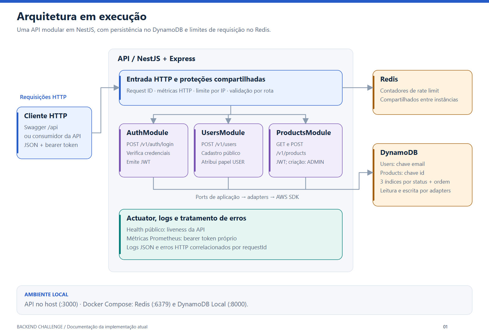
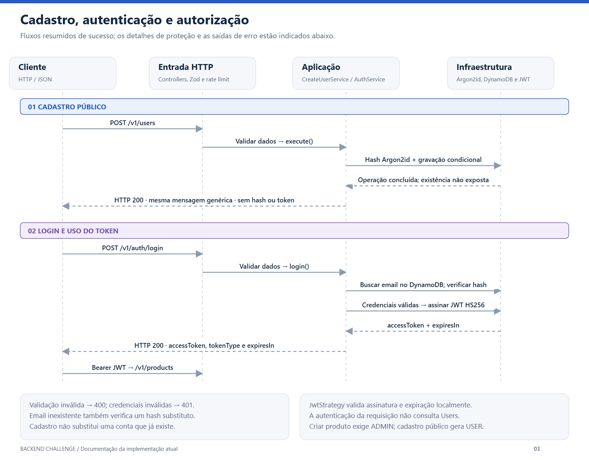

# Arquitetura e funcionamento

Este guia descreve a implementação atual do Backend Challenge. Os diagramas mostram os componentes em execução e os caminhos de cadastro e autenticação.

Os PNGs estão incorporados abaixo; os links para SVG permitem abrir as versões vetoriais com zoom. As cores destacam a entrada HTTP (azul), os módulos e os fluxos de autenticação (roxo), os serviços de apoio (verde) e o armazenamento externo (amarelo).

## 1. Visão geral dos componentes



[Abrir SVG](./diagrams/01-runtime-overview.svg)

O [AppModule](../src/app.module.ts) reúne os módulos da aplicação. O [bootstrap](../src/main.ts) configura os cabeçalhos de segurança, o prefixo `/v1`, o Swagger em `/api` e a porta HTTP. A aplicação usa NestJS com Express.

| Componente                                                       | Responsabilidade e relação com os demais                                                   |
| ---------------------------------------------------------------- | ------------------------------------------------------------------------------------------ |
| [AuthModule](../src/auth/auth.module.ts)                         | Autentica credenciais, usa a porta de leitura de usuários exportada por Users e emite JWT. |
| [UsersModule](../src/users/users.module.ts)                      | Registra usuários e fornece a implementação de persistência e leitura para autenticação.   |
| [ProductsModule](../src/products/products.module.ts)             | Lista e cria produtos; conecta casos de uso, portas e adapters.                            |
| [RateLimitModule](../src/common/rate-limit/rate-limit.module.ts) | Mantém os contadores por IP e usuário no Redis, compartilhados entre instâncias da API.    |
| [CommonModule](../src/common/common.module.ts)                   | Registra o middleware de Request ID e o filtro global de erros.                            |
| [ActuatorModule](../src/actuator/actuator.module.ts)             | Mede requisições HTTP e expõe liveness e métricas Prometheus.                              |
| [DynamoDBModule](../src/database/dynamodb/dynamodb.module.ts)    | Configura o cliente usado pelos adapters de usuários e produtos.                           |

No ambiente local, a API é executada no host e o [Docker Compose](../docker-compose.yml) inicia Redis e DynamoDB Local. O [Terraform](../terraform/README.md) provisiona as tabelas DynamoDB na AWS; ele não provisiona o deploy da API nem o Redis.

O Redis armazena contadores de limite de requisição. As entidades de usuários e produtos ficam no DynamoDB. O endpoint de health é um teste de liveness e não consulta essas dependências. As métricas exigem um bearer token próprio, configurado por `METRICS_BEARER_TOKEN`.

## 2. Cadastro, login e acesso autenticado



[Abrir SVG](./diagrams/03-registration-and-login.svg)

### Cadastro público

`POST /v1/users` tem limite de cinco requisições por minuto por IP. O [schema de cadastro](../src/users/presentation/http/schemas/create-user.schema.ts) valida os dados e rejeita campos adicionais, como `role`.

O [CreateUserService](../src/users/application/use-cases/create-user/create-user.service.ts) normaliza o email, gera o ID e a data, calcula o hash Argon2id e atribui `USER`. O [UsersRepository](../src/users/infrastructure/dynamodb/users.repository.ts) grava com condição de inexistência do email. Uma tentativa de cadastrar o mesmo email não substitui a conta existente e recebe a mesma mensagem genérica com HTTP 200. A resposta não inclui senha, hash nem token.

### Login e autorização

`POST /v1/auth/login` também tem limite de cinco requisições por minuto por IP. O [AuthService](../src/auth/application/login/auth.service.ts) normaliza o email, consulta o usuário e verifica a senha pelo [PasswordHasher](../src/security/password-hasher.port.ts). Se o usuário não existe, o [adapter Argon2id](../src/security/argon2-password-hasher.adapter.ts) ainda executa a verificação com um hash substituto. Credenciais inválidas resultam em HTTP 401.

Com credenciais válidas, o [emissor JWT](../src/auth/infrastructure/jwt/jwt-access-token-issuer.adapter.ts) retorna `accessToken` e `expiresIn`; o serviço acrescenta `tokenType: "Bearer"`. O token é assinado com HS256 e carrega a identificação do usuário e seu papel, além dos campos de tempo.

O cliente envia `Authorization: Bearer <accessToken>` nas rotas de produtos. A [JwtStrategy](../src/auth/infrastructure/jwt/jwt.strategy.ts) valida a assinatura e a expiração localmente e preenche o usuário da requisição. Essa validação não faz uma nova leitura na tabela de usuários. A listagem aceita usuários autenticados; a criação também passa pelo [RolesGuard](../src/common/guards/roles.guard.ts) e exige `ADMIN`.

As setas de retorno do diagrama resumem a resposta HTTP pelo controller; as chamadas aos adapters agrupam operações para facilitar a leitura.

## Atualizar os diagramas

As imagens são geradas localmente pelo [script de diagramas](../scripts/render-architecture-diagrams.mjs), sem serviços externos ou novas dependências npm. Altere os textos e as posições nesse script para manter as duas imagens consistentes.

```bash
npm run docs:diagrams
```

O comando grava os SVGs e os PNGs em [diagrams/](./diagrams/). Os PNGs têm largura de 1600 pixels e fundo claro para leitura no GitHub e em editores Markdown. Os SVGs contêm título e descrição acessíveis e podem ser usados em apresentações sem perda de resolução.

A exportação PNG precisa de Chrome, Chromium ou Edge instalado. O script procura executáveis em caminhos comuns de Windows, Linux e macOS. Para indicar outro caminho, defina `DIAGRAM_BROWSER` com o executável do navegador. O navegador é iniciado em modo headless com um perfil separado em `.tmp/architecture-diagrams/`, ignorado pelo Git.

Para gerar somente SVG, basta Node.js:

```bash
node scripts/render-architecture-diagrams.mjs
```

Versione os SVGs e os PNGs regenerados junto com mudanças na arquitetura ou nos fluxos. Revise também os links e as explicações deste guia.
